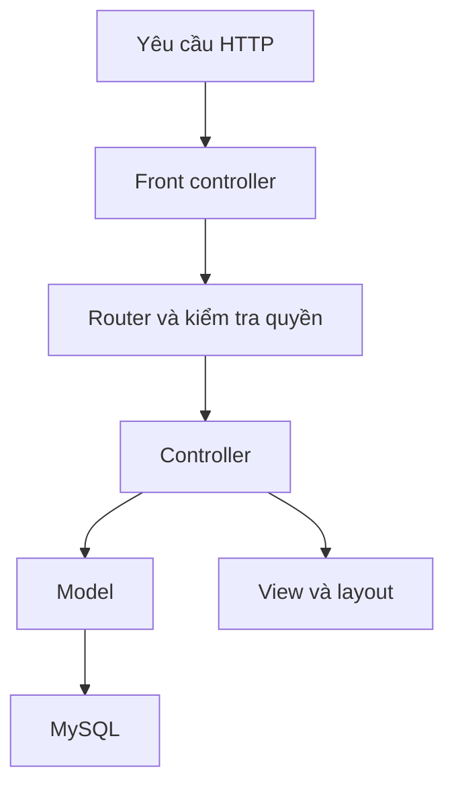
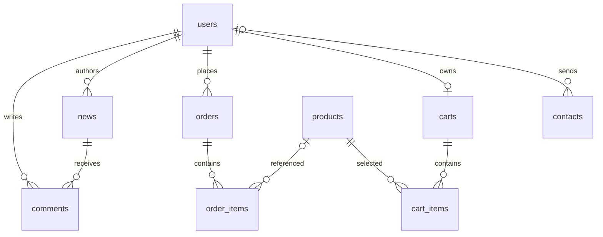

# Thiết kế và hiện thực phần công việc chung

## Mô hình ứng dụng

Website sử dụng PHP thuần theo MVC. `public/index.php` nhận yêu cầu, gọi bootstrap để khởi tạo cấu hình, session và autoload, rồi chuyển yêu cầu cho `Router`. Quy tắc Apache chuyển các đường dẫn động về front controller và phục vụ trực tiếp CSS, JavaScript, ảnh. PDO kết nối MySQL/MariaDB với bảng InnoDB và mã hóa utf8mb4.

| Thành phần | Vai trò |
| --- | --- |
| `app/routes/` | Khai báo HTTP method, đường dẫn, controller và quyền truy cập. |
| `app/core/` | Router, xác thực, CSRF, kiểm tra dữ liệu, upload, phân trang và kết nối PDO. |
| `app/controllers/` | Xử lý đăng ký, đăng nhập, hồ sơ và danh sách người dùng quản trị. |
| `app/models/User.php` | Tra cứu, tạo, cập nhật tài khoản và quản lý trạng thái phiên. |
| `app/views/layouts/main.php` | Layout public gồm header, nội dung, thông báo và footer. |
| `app/views/admin/layouts/main.php` | Layout quản trị, dùng giao diện sidebar từ TailAdmin Free HTML và CSS Tailwind được biên dịch sẵn. |
| `app/views/partials/` | Thành phần dùng chung cho biểu mẫu tài khoản, thông báo và phân trang. |

## Cơ sở dữ liệu

| Bảng | Khóa và dữ liệu chính |
| --- | --- |
| `users` | PK `id`, UNIQUE `email`. Lưu tên, điện thoại, ảnh, hash mật khẩu, vai trò, trạng thái, phiên bản phiên, yêu cầu đổi mật khẩu và dấu thời gian xóa. |
| `site_settings` | PK `setting_key`. Lưu cấu hình chung theo cặp khóa và giá trị. |
| `contacts` | FK `user_id` tùy chọn. Lưu người gửi, chủ đề, nội dung, thời điểm gửi và trạng thái xử lý. |
| `pages` | PK `id`, UNIQUE `slug`. Lưu tiêu đề, nội dung, đường dẫn ảnh và mô tả SEO của trang nội dung. |
| `faqs` | PK `id`. Lưu câu hỏi, câu trả lời, thứ tự và trạng thái hiển thị. |
| `products` | PK `id`, UNIQUE `slug`. Lưu tên, mô tả, giá dạng DECIMAL, tồn kho, ảnh và trạng thái. |
| `carts`, `cart_items` | Mỗi thành viên có tối đa một giỏ. Cặp `cart_id, product_id` là khóa chính dòng giỏ và lưu số lượng. |
| `orders`, `order_items` | Đơn lưu người mua, người nhận, địa chỉ, tổng tiền và trạng thái. Dòng đơn giữ tên và giá tại thời điểm đặt để bảo toàn lịch sử. |
| `news`, `comments` | Bài viết lưu tác giả, slug, nội dung, ảnh, SEO và thời điểm xuất bản. Bình luận gắn với bài viết và tác giả, có điểm đánh giá và trạng thái duyệt. |

Admin xóa mềm thành viên để giữ đơn hàng và bình luận. Tài khoản bị xóa biến mất khỏi danh sách và giữ email đã đăng ký. Khóa ngoại bảo vệ liên kết giữa các bảng. Những bảng nội dung là hợp đồng CSDL cho các module riêng.

## Luồng tài khoản

| Vai trò | Quyền trong phần chung |
| --- | --- |
| Khách | Xem trang công khai, đăng ký, đăng nhập. |
| Thành viên | Chỉnh hồ sơ, email (xác nhận mật khẩu hiện tại), mật khẩu và ảnh đại diện. |
| Quản trị viên | Có hồ sơ riêng, xem và tìm tài khoản theo tên hoặc email, phân trang, sửa thông tin thành viên, đặt lại mật khẩu, khóa, mở khóa và xóa mềm thành viên. |

Đăng ký luôn tạo vai trò `member`. Admin được tạo bằng CLI. Khi đặt lại mật khẩu, admin cung cấp mật khẩu tạm qua kênh riêng. Lần đăng nhập tiếp theo yêu cầu đổi mật khẩu trước khi sử dụng chức năng thành viên. Đổi mật khẩu, đặt lại mật khẩu, khóa hoặc xóa sẽ tăng `session_version`. Mỗi yêu cầu có phiên đăng nhập kiểm tra lại phiên bản, trạng thái và vai trò từ CSDL.

## Kiểm tra đầu vào, bảo mật và SEO

- Trình duyệt dùng các ràng buộc HTML và JavaScript để kiểm tra mật khẩu xác nhận, số điện thoại, ảnh và yêu cầu xác nhận khi đổi email. Server kiểm tra độc lập.
- Các route POST kiểm tra CSRF. Mật khẩu lưu bằng `password_hash`, kiểm tra bằng `password_verify`. Session đổi ID sau khi xác thực và dùng cookie HttpOnly, Secure khi có HTTPS, SameSite=Lax trên PHP 7.3 trở lên. Đăng nhập giới hạn số lần thử trong từng phiên.
- Model sử dụng prepared statement cho dữ liệu đầu vào. View escape dữ liệu bằng `e()`. Kiểm tra quyền tại router và giới hạn truy vấn sửa, khóa, reset, xóa vào tài khoản thành viên.
- Upload ảnh kiểm tra dung lượng, MIME thực và kích thước ảnh. Tệp dùng tên ngẫu nhiên và allowlist JPEG, PNG, WebP. Thư mục upload được cấu hình để Apache từ chối các tệp ngoài định dạng ảnh.
- Layout nhận `title`, `metaDesc` và `noIndex`. Trang tài khoản và quản trị có chỉ thị noindex. Giao diện dùng viewport, bố cục co giãn và vùng cuộn ngang cho bảng quản trị.

## Tích hợp module riêng

- Khai báo route trong file của module. Dùng `['requireMember']` cho thao tác thành viên như gửi đánh giá và `['requireAdmin']` cho quản trị. Form POST cần `Csrf::field()`.
- Gọi `$this->view('module/action', $data)` cho public hoặc truyền `'admin/layouts/main'` làm tham số thứ ba. Bổ sung liên kết điều hướng khi route tương ứng đã hoạt động.
- Dùng `Pagination` cho danh sách. Đặt `$paginationPath` và `$paginationQuery` trước khi include partial phân trang.
- Dùng `Upload::image()` với thư mục `avatars`, `site`, `products` hoặc `news`. Lưu đường dẫn tương đối trả về từ helper vào CSDL và hiển thị bằng `base_url()`.
- CSS quản trị được biên dịch từ `src/css/style.css` của TailAdmin Free HTML 2.5.1. Khi thêm class Tailwind mới, cấu hình `@source` trỏ tới `app/views/admin` và biên dịch lại bằng Tailwind CLI. Mã nguồn và giấy phép đi kèm để đối chiếu.

## Kịch bản demo

1. Đăng ký thành viên, thử email trùng và mật khẩu xác nhận sai, rồi đăng nhập hợp lệ.
2. Sửa họ tên và điện thoại, thử đổi email với mật khẩu hiện tại sai, rồi cập nhật bằng mật khẩu đúng.
3. Tải ảnh PNG/JPEG/WebP, sau đó chọn tệp văn bản để kiểm tra thông báo lỗi.
4. Đổi mật khẩu và đăng nhập lại. Thử mở trang quản trị từ tài khoản thành viên.
5. Đăng nhập admin ở cửa sổ khác. Tìm thành viên, mở chi tiết và sửa thông tin. Tạo trên 10 tài khoản để kiểm tra trang tiếp theo và tìm kiếm xuyên suốt danh sách.
6. Khóa thành viên trong lúc thành viên đang đăng nhập, kiểm tra phiên cũ và thử đăng nhập. Mở khóa và đăng nhập lại.
7. Đặt lại mật khẩu. Đăng nhập bằng mật khẩu tạm và đổi mật khẩu trước khi chỉnh hồ sơ. Xóa mềm thành viên và kiểm tra danh sách cùng quyền truy cập.
8. Thử thu nhỏ cửa sổ xuống kích thước điện thoại và kiểm tra các trang đăng ký, hồ sơ, danh sách quản trị.

## Kết quả kiểm tra

| Phạm vi | Kết quả |
| --- | --- |
| Apache 2.4, PHP 8.4, MariaDB 11.8 | Import 6 migration và seed. Kiểm tra cú pháp 48 file PHP. |
| HTTP | Đăng ký, email trùng, CSRF, kiểm tra quyền, cập nhật hồ sơ, đổi mật khẩu, upload và thay ảnh. Admin tìm kiếm, phân trang, sửa, khóa, mở khóa, reset, buộc đổi mật khẩu và xóa mềm. |
| Nu HTML Checker | Kiểm tra 11 bản HTML đã render và cả hai stylesheet, không có lỗi. |
| Firefox và Chromium | Kiểm tra ở 390, 768 và 1440 px. Kiểm tra xác nhận mật khẩu bằng JavaScript và điều hướng quản trị. |

## Tham khảo

- [TailAdmin Free HTML](https://github.com/TailAdmin/tailadmin-free-tailwind-dashboard-template) · [Giấy phép MIT](../TAILADMIN-LICENSE.txt)
- [PHP Password Hashing](https://www.php.net/manual/en/book.password.php)
- [Nu HTML Checker](https://validator.w3.org/nu/) · [W3C CSS Validator](https://jigsaw.w3.org/css-validator/)
